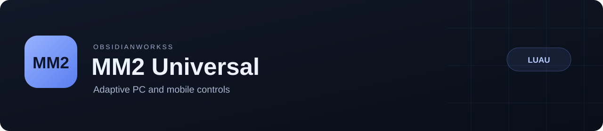

<p align="center">
  
</p>

<p align="center">
  <a href="https://github.com/ObsidianWorkss/Murder-Mystery-2/actions/workflows/validate.yml"></a>
  
  
</p>

<p align="center">
  <a href="#quick-start">Quick start</a> ·
  <a href="docs/FEATURES.md">Feature guide</a> ·
  <a href="CHANGELOG.md">Changelog</a> ·
  <a href="docs/SUPPORT.md">Support</a> ·
  <a href="CONTRIBUTING.md">Contributing</a>
</p>

# MM2 Universal

A Luau toolkit for Murder Mystery 2 with a bundled WindUI menu, adaptive PC and phone controls, combat assistance, role visuals and movement tools.

**Current build: v1.0.0-rc.43.** Automated validation covers **1,017 Luau assertions**, **33 Windows companion checks** and compilation of both runtime scripts. This update improves ESP readiness, allows triggerbot use during stable invisibility and recognizes the current nested voting pads. Live Classic checks confirmed seven attached player visuals and automatic gun requests. Halloween combat/rendering, streamer capture and real phone rendering remain pending; see the [validation record](tests/VALIDATION.md) and [release checklist](docs/RELEASE_CHECKLIST.md).

## Quick start

Run the latest script in a compatible client scripting environment:

```lua
loadstring(game:HttpGet("https://raw.githubusercontent.com/ObsidianWorkss/Murder-Mystery-2/refs/heads/main/main.lua"))()
```

1. Enter your access key when prompted. Keys are supplied by the repository owner; never post them in issues.
2. Equip your gun or knife through the native inventory.
3. Open the menu with **Right Shift** on PC or **MM2** on a phone. On phones, **Pages** switches sections.
4. Choose the features you need. Use **End** on PC or **Stop** on a phone to cancel active actions.

The loader follows `main`, so re-run it to receive updates. [`loader.lua`](loader.lua) adds clearer download, compilation and startup errors. For a fixed offline copy, use `main.lua` from a [versioned release](https://github.com/ObsidianWorkss/Murder-Mystery-2/releases).

### Requirements

| Capability | Purpose |
| --- | --- |
| Compatible Luau client environment | Runs the bundled script; support varies by device and executor. |
| `loadstring` and HTTP access | Required by the online loader. |
| Local file APIs | Optional; remember a valid key and save settings. |
| Clipboard and simulated touch APIs | Optional; availability appears in the support report. |

## Features at a glance

For a separate script with no UI, see the [standalone coin farm](docs/AUTO_FARM.md). Ground paths are the default; a separate experimental loader selects prone/noclip underground tweens. Both modes pause for full bags, request one server-confirmed full-bag reset per round and can fund normal Mystery Box #2 rolls from balance growth above their starting Coins. It adds 59 regression checks alongside the main script's 1,017. Underground server acceptance is unverified after an earlier position-validation kick; drops and invulnerability are not guaranteed.

| Area | Included |
| --- | --- |
| Combat | Gun aim, predicted knife throws, separate gun/knife triggerbots, aura, explicit Kill all actions and result counters. |
| Phone controls | Default Invis, Speed, Trigger and Aura shortcuts; More and Stop; draggable controls and compact landscape layouts. |
| Visuals | Role ESP, dropped-gun ESP, X-ray, optional status cards and display presets. |
| Halloween modes | Zombie/Survivor and Freezer/Runner role colors, mode-aware weapon targeting, event guidance and shared round detection. |
| Streamer mode | Experimental Windows companion mirrors supported 2D UI into a separate capture-excluded overlay; manual setup and clip verification required. |
| Movement | Speed, jump, fly, noclip, knife dodge, anti-fling and animation packs. |
| Session tools | Protected-player lists, saved preferences, equip recovery, repair controls and support reports. |

The [feature guide](docs/FEATURES.md) documents exact settings, default states, pause conditions, cooldowns and experimental behavior.

**Server outcomes are not guaranteed.** The server decides whether damage, range, movement and other requests are accepted. Sent requests and observed eliminations are reported separately. Passing local tests does not establish live device compatibility or server acceptance.

## Controls

| Action | PC default | Phone |
| --- | --- | --- |
| Open / close menu | Right Shift | MM2 |
| Equip / holster | 1, native inventory | Native weapon icon |
| Fire / stab | Left click | Fire / Stab |
| Throw knife | E or right click | Throw |
| Emergency stop | End | Stop |
| Universal triggerbot | T | Trigger |
| Invisibility | F8 | Invis |
| Speed boost | G | Speed |
| Kill aura | K | Aura |
| Knife dodge | Unbound; Settings → Combat keys | More → Dodge |
| Streamer mode | F4; Windows companion required | Windows only |

Keys can be changed in **Settings**. See [all controls and reserved keys](docs/FEATURES.md#controls).

### Designed for phones

The full menu starts closed, and the instruction card is hidden by default to leave the inventory clear. The shortcut dock is visible without enabling invisibility, speed, triggerbot or aura. **More** contains Fly, Noclip, Dodge and Kill all.

Use **Settings → General** to reset button positions or change phone startup preferences. Instructions can be enabled under **Visuals → HUD & Alerts**. Layout geometry is tested in portrait and landscape; actual touch rendering is still a live check.

## Documentation

| Resource | What it covers |
| --- | --- |
| [Feature guide](docs/FEATURES.md) | Full behavior, requirements, controls and troubleshooting. |
| [Windows streamer setup](docs/STREAMER_MODE.md) | Companion build/start, OBS source settings, recovery and known capture limits. |
| [Support](docs/SUPPORT.md) | Recovery steps and reproducible bug reports. |
| [Changelog](CHANGELOG.md) | Version-by-version changes. |
| [Validation](tests/VALIDATION.md) | Automated results and specific live observations. |
| [Release checklist](docs/RELEASE_CHECKLIST.md) | Checks still required before a stable release. |
| [Contributing](CONTRIBUTING.md) | Repository layout, development workflow and pull requests. |

## Development

Python 3 and Luau **0.739** are used for local validation:

```sh
luau-compile --null main.lua loader.lua
python tests/run.py --luau /path/to/luau
python tools/package.py --output dist
```

GitHub Actions compiles both scripts, runs the regression suites and verifies the release archive. A separate Windows job builds and tests the companion without opening its window. The workflow pins the Luau source revision. Packaging uses an explicit file list and produces `MANIFEST.json` and `SHA256SUMS.txt`; local keys, generated connection tokens and repository metadata are excluded.

## Support and attribution

[Report a bug](https://github.com/ObsidianWorkss/Murder-Mystery-2/issues/new?template=bug_report.yml) or [suggest an improvement](https://github.com/ObsidianWorkss/Murder-Mystery-2/issues/new?template=feature_request.yml). Include the build, device and reproduction steps. **Settings → Copy support report** collects diagnostics without access keys or player identities.

The bundled WindUI and Footages Icons copyright and license notices are preserved. See [third-party notices](THIRD_PARTY_NOTICES.md) before redistributing the bundle.
